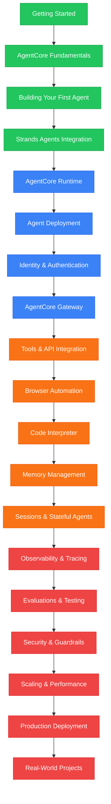

# AgentCore Masterclass

> Venkata Bhattaram (c) 2026

An extensive, beginner-to-expert **Amazon Bedrock AgentCore Masterclass** with hands-on code examples — from installing the AgentCore SDK and building your first AI agent, through AgentCore Runtime, agent deployment, identity and authentication, gateway integration, tool connectivity, browser automation, code execution, memory management, session handling, observability, evaluations, security, production deployment, and real-world agentic AI projects.

## Learning Path

**Green = Beginner** &nbsp; | &nbsp; **Blue = Intermediate** &nbsp; | &nbsp; **Orange = Advanced** &nbsp; | &nbsp; **Red = Expert**

The Masterclass progressively moves from foundational agent development to managed agent infrastructure, connected tools, persistent memory, production observability, and scalable agentic AI applications.

**Installation → AgentCore Fundamentals → First Agent → Strands Integration → Runtime → Deployment → Identity → Gateway → Tool Integration → Browser Automation → Code Execution → Memory → Stateful Agents → Observability → Evaluation → Security → Scaling → Production → Real-World Projects**

## CONTENTS

### 01. Foundations
- [Installation](./01-get-started/md/installer.md)

